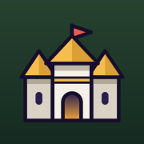

# SVG 도감

월드맵과 상세 화면은 같은 SVG 원본을 사용합니다. 데스크톱 기준 왕궁은 96px, 개발 광장은 80px, PR 시설은 48px입니다. Codex·Claude는 28px, 파티장은 32px입니다. 연결된 커밋 수에 따라 일반 몬스터는 32~56px, 보스는 64~80px로 자랍니다. 유산은 누적 지표에 따라 40~88px로 성장합니다. 모바일에서는 월드맵 전체에 같은 배율을 적용합니다. 모든 SVG는 `vector-effect: non-scaling-stroke`를 사용해, 표시 크기와 관계없이 외곽선이 1.5px로 그려집니다. 왕궁, 개발 광장, 해자와 다리, 유산은 그 위에 외곽선 없는 면으로 음영과 장식을 더해, 크게 표시될수록 세부가 드러납니다. PR 시설과 캐릭터는 외곽선 위주의 단순한 그림을 유지합니다. 파일명을 누르면 원본을 열 수 있습니다.

## 캐릭터와 몬스터

| 미리보기                                              | 이름        | 표시 기준                  | 원본                                                                |
| ----------------------------------------------------- | ----------- | -------------------------- | ------------------------------------------------------------------- |
|       | 파티장      | PR에서 CI 실행 중          | [party-leader.svg](../assets/characters/party-leader.svg)           |
|    | Codex       | 참여가 확인된 Codex        | [adventurer-codex.svg](../assets/characters/adventurer-codex.svg)   |
|  | Claude      | 참여가 확인된 Claude       | [adventurer-claude.svg](../assets/characters/adventurer-claude.svg) |
|            | 몬스터      | 일반 이슈                  | [monster.svg](../assets/characters/monster.svg)                     |
|  | 보스 몬스터 | 하위 이슈가 있는 상위 이슈 | [monster-boss.svg](../assets/characters/monster-boss.svg)           |

## 왕궁과 유산

| 미리보기                                                    | 이름        | 표시 기준                       | 원본                                                                     |
| ----------------------------------------------------------- | ----------- | ------------------------------- | ------------------------------------------------------------------------ |
|                        | 왕궁        | 저장소의 중심                   | [palace.svg](../assets/kingdom/palace.svg)                               |
|                         | 개발 광장   | 개발 브랜치의 중심              | [plaza.svg](../assets/kingdom/plaza.svg)                                 |
|            | 해자와 다리 | 왕궁과 개발 광장 사이           | [moat-bridge.svg](../assets/kingdom/moat-bridge.svg)                     |
|        | 완공 기념비 | 머지된 PR                       | [legacy-monument.svg](../assets/kingdom/legacy-monument.svg)             |
|  | 영웅의 전당 | completed 사유로 종료된 이슈    | [legacy-hall-of-heroes.svg](../assets/kingdom/legacy-hall-of-heroes.svg) |
|         | 기록 보관소 | 이슈·PR 대화와 코드 인라인 댓글 | [legacy-archive.svg](../assets/kingdom/legacy-archive.svg)               |
|    | 현자의 서고 | 제출된 PR 리뷰                  | [legacy-sage-library.svg](../assets/kingdom/legacy-sage-library.svg)     |

## PR 시설

PR 제목 맨 앞의 GitMoji가 시설을 결정합니다.

| 미리보기                                                     | 이름           | 표시 기준                                                    | 원본                                                                        |
| ------------------------------------------------------------ | -------------- | ------------------------------------------------------------ | --------------------------------------------------------------------------- |
|                     | 대장간         | ✨ 기능 추가                                                 | [forge.svg](../assets/facilities/forge.svg)                                 |
|       | 성벽 수리 현장 | 🐛 버그 수정                                                 | [wall-repair.svg](../assets/facilities/wall-repair.svg)                     |
|                      | 정원           | 💄 UI·스타일                                                 | [garden.svg](../assets/facilities/garden.svg)                               |
|                   | 도서관         | 📝 문서                                                      | [library.svg](../assets/facilities/library.svg)                             |
|           | 훈련장         | ✅ 테스트                                                    | [training-ground.svg](../assets/facilities/training-ground.svg)             |
|       | 기계 공방      | ⚡ 성능                                                      | [machine-workshop.svg](../assets/facilities/machine-workshop.svg)           |
|  | 건축 공방      | ♻️ 리팩터링. 미분류 PR의 기본 공방도 같은 그림을 사용합니다. | [architecture-workshop.svg](../assets/facilities/architecture-workshop.svg) |
|               | 경비탑         | 🔒 보안                                                      | [guard-tower.svg](../assets/facilities/guard-tower.svg)                     |
|               | 릴리즈 포탈    | 🚀 배포                                                      | [portal.svg](../assets/facilities/portal.svg)                               |
|             | 관제탑         | 👷 💚 CI·자동화                                              | [control-tower.svg](../assets/facilities/control-tower.svg)                 |
|              | 보급소         | 🔧 📦 ⬆️ ⬇️ 설정·패키지·의존성                               | [supply-depot.svg](../assets/facilities/supply-depot.svg)                   |
|               | 관측소         | 📈 🔊 분석·로그                                              | [observatory.svg](../assets/facilities/observatory.svg)                     |

그림과 화면의 대응 관계는 [SVG 등록 목록](../src/world-art.tsx), PR 제목 분류 규칙은 [시설 분류 코드](../src/facility-kind.ts)에서 확인할 수 있습니다.

## 사이트 아이콘

브라우저 탭과 홈 화면에 쓰는 아이콘입니다. 월드맵의 왕궁과 같은 구성이지만, 작은 크기에 맞춰 비율과 선 굵기를 조정한 별도 그림이며 월드맵에는 쓰지 않습니다. 배경은 투명입니다. 16px에서도 선이 뭉치지 않도록 외곽선 굵기를 고정하지 않고 크기에 따라 함께 줄어들게 했습니다. `index.html`은 32px PNG와 SVG를 함께 선언합니다. SVG 아이콘을 지원하는 브라우저는 SVG를, 그렇지 않은 브라우저는 PNG를 씁니다. 홈 화면 아이콘은 같은 그림에 여백을 둔 180px PNG이며 배경을 넣지 않았습니다. 두 PNG는 SVG에서 변환한 것이므로 SVG를 고치면 다시 만듭니다.

| 미리보기                                                | 이름           | 표시 기준                 | 원본                                                                                         |
| ------------------------------------------------------- | -------------- | ------------------------- | -------------------------------------------------------------------------------------------- |
|            | 사이트 아이콘  | 브라우저 탭과 북마크      | [favicon.svg](../assets/brand/favicon.svg), [favicon-32.png](../assets/brand/favicon-32.png) |
|  | 홈 화면 아이콘 | 홈 화면에 추가한 바로가기 | [apple-touch-icon.png](../assets/brand/apple-touch-icon.png)                                 |
